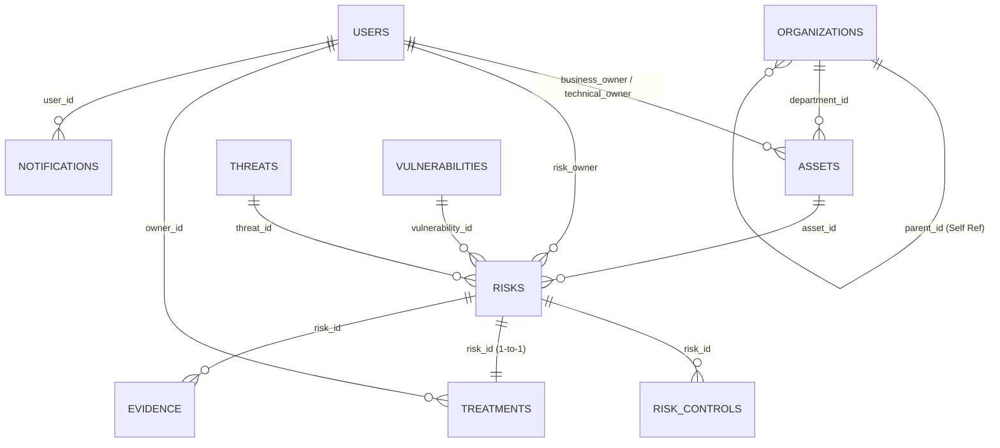

# Database Schema, Relations & Storage Architecture

Aegis GRC uses Cloudflare D1 (SQLite) as its primary transactional database. Drizzle ORM acts as the compiler translating TypeScript schema definitions into optimized SQLite SQL queries.

This document details the tables, relationships, column types, constraints, and optimization strategies of the database.

---

## 📊 Entity Relationship Diagram

---

## 🗄️ Detailed Table Schemas

### 1. `organizations`
Defines the corporate structure (Business Units, Divisions, Departments, Teams).
* **`id`** (`TEXT`): Primary Key (UUID).
* **`name`** (`TEXT`): Name of the node (e.g. *Cloud Infrastructure*).
* **`type`** (`TEXT`): Restrained via check constraint: `'company'`, `'division'`, `'department'`, `'team'`.
* **`parentId`** (`TEXT`): Self-referencing Foreign Key pointing to `organizations.id` ON DELETE CASCADE. Allows infinite nesting.
* **`location`** (`TEXT`): Physical or virtual location (e.g. *AWS Cloud*, *Dallas HQ*).
* **`createdAt` / `updatedAt`** (`INTEGER`): Epoch milliseconds.

### 2. `users`
Directories of pre-registered and active corporate logins.
* **`id`** (`TEXT`): Primary Key. Initially generated as a placeholder UUID, overwritten with the Firebase UID during the first-time sign-in.
* **`email`** (`TEXT`): Unique corporate email address. Indexed.
* **`name`** (`TEXT`): Name of the user.
* **`role`** (`TEXT`): Restrained via check constraint: `'super_admin'`, `'ciso'`, `'risk_manager'`, `'auditor'`, `'asset_owner'`, `'risk_owner'`, `'department_head'`, `'viewer'`.
* **`status`** (`TEXT`): Restrained via check: `'active'`, `'locked'`, `'pending'`.
* **`departmentId`** (`TEXT`): Foreign Key pointing to `organizations.id` ON DELETE SET NULL. Used to set the data scope for Department Heads.
* **`createdAt` / `updatedAt`** (`INTEGER`): Epoch milliseconds.

### 3. `assets`
The inventory of hardware, software, databases, or API components.
* **`id`** (`TEXT`): Primary Key (UUID).
* **`assetId`** (`TEXT`): Human-readable identifier (e.g. `AST-101`). Unique, indexed.
* **`name`** (`TEXT`): Name of the asset.
* **`type`** (`TEXT`): Type of asset (e.g., `'database'`, `'server'`, `'application'`, `'api'`, `'cloud_storage'`).
* **`criticality`** (`TEXT`): Criticality score (e.g. `'critical'`, `'high'`, `'medium'`, `'low'`).
* **`ciaConfidentiality` / `ciaIntegrity` / `ciaAvailability`** (`INTEGER`): CIA rating values from 1 (Low) to 3 (High).
* **`dataClassification`** (`TEXT`): Data classification tier (e.g. `'restricted'`, `'confidential'`, `'internal'`, `'public'`).
* **`businessOwnerId`** (`TEXT`): Foreign Key referencing `users.id` ON DELETE SET NULL.
* **`technicalOwnerId`** (`TEXT`): Foreign Key referencing `users.id` ON DELETE SET NULL.
* **`departmentId`** (`TEXT`): Foreign Key referencing `organizations.id` ON DELETE CASCADE.
* **`description`** (`TEXT`): Description of the asset.
* **`createdAt` / `updatedAt`** (`INTEGER`): Epoch milliseconds.

### 4. `risks`
The risk register documenting identified vulnerabilities, impacts, and strategies.
* **`id`** (`TEXT`): Primary Key (UUID).
* **`riskId`** (`TEXT`): Human-readable identifier (e.g., `RSK-101`). Unique, indexed.
* **`title`** (`TEXT`): Title of the risk.
* **`description`** (`TEXT`): Description of the risk.
* **`assetId`** (`TEXT`): Foreign Key referencing `assets.id` ON DELETE CASCADE.
* **`threatId`** (`TEXT`): Foreign Key referencing `threats.id` ON DELETE SET NULL.
* **`vulnerabilityId`** (`TEXT`): Foreign Key referencing `vulnerabilities.id` ON DELETE SET NULL.
* **`inherentImpact` / `inherentLikelihood`** (`INTEGER`): Raw impact/likelihood ratings (Scale: 1 to 5).
* **`inherentScore`** (`INTEGER`): Calculated automatically: `inherentImpact * inherentLikelihood` (Scale: 1 to 25).
* **`residualImpact` / `residualLikelihood`** (`INTEGER`): Residual impact/likelihood ratings (Scale: 1 to 5).
* **`residualScore`** (`INTEGER`): Calculated automatically: `residualImpact * residualLikelihood` (Scale: 1 to 25).
* **`treatmentStrategy`** (`TEXT`): Chosen strategy: `'mitigate'`, `'accept'`, `'transfer'`, `'avoid'`.
* **`riskOwnerId`** (`TEXT`): Foreign Key referencing `users.id` ON DELETE SET NULL.
* **`status`** (`TEXT`): Restrained via check: `'identified'`, `'treating'`, `'accepted'`, `'closed'`.
* **`createdAt` / `updatedAt`** (`INTEGER`): Epoch milliseconds.

### 5. `risk_controls`
Joint table linking control mitigations to active risk instances.
* **`id`** (`TEXT`): Primary Key (UUID).
* **`riskId`** (`TEXT`): Foreign Key referencing `risks.id` ON DELETE CASCADE.
* **`controlName`** (`TEXT`): Name of the control (e.g. *VPN Tunneling*).
* **`controlDescription`** (`TEXT`): Description of the control.
* **`status`** (`TEXT`): Restrained: `'implemented'`, `'partially_implemented'`, `'planned'`.
* **`createdAt`** (`INTEGER`): Epoch milliseconds.

### 6. `treatments`
Remediation action plans mapped to mitigation risks.
* **`id`** (`TEXT`): Primary Key (UUID).
* **`riskId`** (`TEXT`): Unique Foreign Key pointing to `risks.id` ON DELETE CASCADE (Enforces 1-to-1 mapping).
* **`description`** (`TEXT`): Action plan details.
* **`ownerId`** (`TEXT`): Foreign Key referencing `users.id` ON DELETE SET NULL.
* **`dueDate`** (`TEXT`): Target date.
* **`budget`** (`INTEGER`): Budget allocation in USD.
* **`progressPercent`** (`INTEGER`): Implementation progress (Scale: 0 to 100).
* **`status`** (`TEXT`): Plan status: `'planned'`, `'in_progress'`, `'completed'`, `'deferred'`.
* **`createdAt` / `updatedAt`** (`INTEGER`): Epoch milliseconds.

### 7. `evidence`
Stores audit files (e.g. screenshots, logs, policy documents) proving compliance.
* **`id`** (`TEXT`): Primary Key (UUID).
* **`name`** (`TEXT`): Original uploaded filename.
* **`fileData`** (`TEXT`): **Base64 encoded file binary contents.**
* **`fileSize`** (`INTEGER`): File size in bytes.
* **`mimeType`** (`TEXT`): Content type (e.g., `'application/pdf'`, `'image/png'`).
* **`riskId` / `assetId` / `treatmentId`** (`TEXT`): Foreign Key relationships referencing mapping tables. ON DELETE CASCADE.

### 8. `audit_logs`
Immutable log ledger recording system modifications.
* **`id`** (`TEXT`): Primary Key (UUID).
* **`userId`** (`TEXT`): Author primary key UID.
* **`userEmail`** (`TEXT`): Author email.
* **`action`** (`TEXT`): Event token (e.g. `'ASSET_CREATE'`, `'USER_LOCK'`).
* **`details`** (`TEXT`): Serialized JSON payload capturing before/after states.
* **`ipAddress`** (`TEXT`): Remote client IP.
* **`createdAt`** (`INTEGER`): Immutable Epoch timestamp.
* *Note: No endpoints exist to update or delete records from this table.*

---

## 🔐 Registration Claiming Workflow

Aegis GRC implements a pre-registration claiming flow to enforce strict security:
1. **Provisioning:** An administrator registers a new user email and role (e.g., `auditor`) inside the directory. The backend generates a temporary user record with a placeholder UUID.
2. **Registration:** The employee registers their account through the Firebase sign-up page. Firebase assigns them a unique Firebase UID (e.g. `FIREBASE_UID_123`).
3. **Claiming Middleware:** When the user logs in for the first time, the Hono auth middleware:
   * Detects if the logged-in email matches a pre-registered database record.
   * If matched, it claims the account by updating the database record: changing the temporary placeholder UUID to the actual `FIREBASE_UID_123`.
   * Subsequent requests match their Firebase token directly to their D1 database profile.

---

## 📦 Base64 Database Storage Strategy

To ensure Aegis GRC operates cost-free on Cloudflare's free tiers without requiring users to configure external cloud storage buckets, audit evidence attachments are stored directly in the SQLite database:

* **Format:** Files are read in the browser, encoded into a Base64 string, and passed as JSON payloads to Hono. Hono saves these strings in the `fileData` text column of the `evidence` table.
* **Download:** When downloading, the API reads the Base64 string from D1, decodes it into a binary stream, and returns it with standard headers (`Content-Type`, `Content-Disposition`) to trigger a file save dialog in the user's browser.
* **Performance Control:** To prevent database bloat, the frontend enforces a strict **5MB file size limit** on uploads, ensuring SQLite queries compile quickly.
